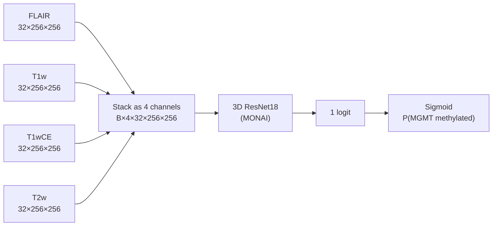
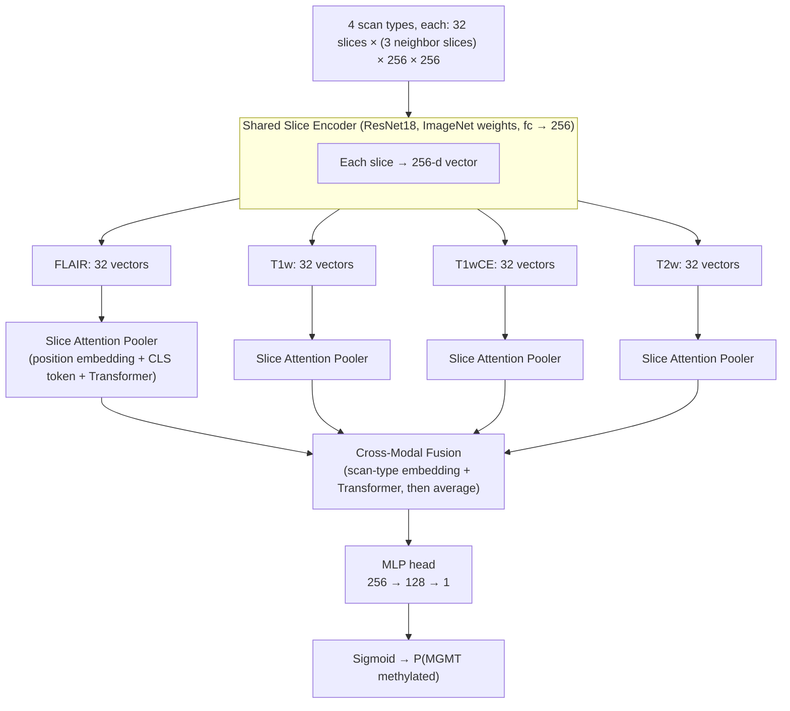

# Brain Tumor Radiogenomic Classification (MGMT Prediction)

Predict the **MGMT promoter methylation** status of a brain tumor (a genetic marker that matters for treatment) from **multi-parametric MRI (mpMRI)** scans.

This project is based on the Kaggle competition [RSNA-MICCAI Brain Tumor Radiogenomic Classification](https://www.kaggle.com/competitions/rsna-miccai-brain-tumor-radiogenomic-classification). The model outputs the probability that MGMT is methylated, and is scored with **ROC-AUC**.

> ⚠️ Research prototype. Not for medical use.

---

## Highlights

- Two approaches, side by side:
  - **3D CNN**: sees the whole MRI volume at once.
  - **2.5D Transformer model**: a 2D CNN looks at each slice, then attention combines slices and scan types.
- Uses all 4 MRI scan types: **FLAIR, T1w, T1wCE, T2w**.
- K-fold cross-validation and fold ensembling for the final prediction.
- Explainability (XAI) tools for the 2.5D model: scan-type importance, slice importance, and Grad-CAM heatmaps.

---

## Repository Structure

```
.
├── configs.py                 # All settings (paths, image size, learning rates, ...)
├── assets/
│   └── train_labels.csv       # BraTS21ID + MGMT_value (0/1)
├── 3d/
│   ├── main.py                # 5-fold training for the 3D model
│   ├── Train/Trainer.py       # Training / validation loop
│   ├── model/Model3d.py       # 3D ResNet (MONAI)
│   ├── data/
│   │   ├── BrainMRIDataset3D.py
│   │   ├── dicom3dloader.py   # Reads DICOM slices
│   │   └── augment.py         # MONAI transforms
│   ├── utils/utils.py         # Loss/AUC plot
│   └── notebooks/             # Kaggle notebook
├── 25d/
│   ├── main.py                # Training + XAI demo for the 2.5D model
│   ├── Train/Trainer25.py     # Training loop (progressive unfreezing)
│   ├── model/model25d.py      # Slice encoder + attention + fusion
│   ├── data/
│   │   ├── BrainMRIDataset25D.py  # Builds 3-neighbor slice stacks
│   │   ├── dicom3dloader.py
│   │   └── augment.py
│   ├── XAI/xai.py             # Explanations (MRIExplainer)
│   └── utils/utils.py
└── LICENSE
```

---

## Data

- **Input:** DICOM MRI scans, 4 types per patient: `FLAIR`, `T1w`, `T1wCE`, `T2w`.
- **Labels:** `assets/train_labels.csv` with columns `BraTS21ID`, `MGMT_value`.
- **Excluded cases:** `00109`, `00123`, `00709` (removed in training code).
- **Data path:** the loader reads from the Kaggle folder
  `/kaggle/input/competitions/rsna-miccai-brain-tumor-radiogenomic-classification/{train|test}/{id}/{scan_type}/*.dcm`.
  Change it in `dicom3dloader.py` if you run elsewhere.

### Preprocessing (same for both models)

1. For each scan type, take the **32 middle slices** (the tumor is usually near the center).
2. Apply the DICOM display window (VOI LUT).
3. Resize to **32 × 256 × 256**.
4. Normalize intensity (ignoring the black background).
5. Training augmentations (MONAI): flips, small rotations, zoom, noise, brightness shift/scale, bias field, Gibbs noise. The same random change is applied to all 4 scan types of a patient.

---

## Models

### 1) 3D Model

The 4 scan types are stacked as **4 input channels** and passed to one 3D ResNet (MONAI, `resnet18` by default; `resnet10` and `efficientnet` also available). It outputs **one logit** (raw score), which becomes a probability with a sigmoid.



### 2) 2.5D Model

"2.5D" means we use a **2D CNN on slices**, but give each slice its **two neighbors** as extra channels (previous, current, next → acts like a 3-channel image). Then attention layers combine the information.



**Parts explained:**

| Part | What it does |
|------|--------------|
| Slice Encoder | One shared ResNet18 turns every slice into a 256-number summary. |
| Slice Attention Pooler | One per scan type. Learns which slices matter and merges 32 slices into 1 vector (using a CLS token, a "summary" token). |
| Cross-Modal Fusion | Lets the 4 scan-type vectors "talk" to each other, then averages them. |
| MLP head | Small network that gives the final score. |

---

## Training

| Setting | 3D Model | 2.5D Model |
|---------|----------|------------|
| Validation | 5-fold stratified (keeps class balance) | 10-fold split, first 3 folds trained |
| Loss | BCE with `pos_weight` (balances classes) | same |
| Optimizer | AdamW + cosine learning-rate decay | AdamW (different LR for backbone and head) + cosine decay |
| Tricks | Mixed precision (AMP), gradient accumulation (4), early stopping | AMP, gradient accumulation, early stopping, **progressive unfreezing** (backbone starts frozen; `layer4` is unlocked later) |
| Final prediction | Average of the fold models | Average of the fold models |

Best model per fold is saved by validation AUC.

---

## Explainability (2.5D model)

`25d/XAI/xai.py` → `MRIExplainer` gives three simple explanations:

1. **Scan-type importance:** how much the prediction changes when one scan type is blanked out.
2. **Slice importance:** which slices the model relied on.
3. **Grad-CAM heatmap:** where inside the slice the model looked (red/yellow = pushed toward "methylated").

```python
explainer = MRIExplainer(weights_dir='./assets/25weights', folds=range(3), device='cuda')
res = explainer.explain(df, scan_id='00005', split='train')
explainer.plot(res, scan_id='00005', save_path='xai_00005.png')
explainer.global_modality_importance(df, df['BraTS21ID'].tolist()[:40])
```

---

## Getting Started

### Install

```bash
pip install torch torchvision monai pydicom pandas numpy scikit-learn tqdm matplotlib seaborn transformers
```

### Train

```bash
# 3D model (5-fold)
cd 3d
python main.py

# 2.5D model (+ XAI example at the end)
cd 25d
python main.py
```

### Settings

Edit `configs.py`:

- `NUM_SLICES` (32), `IMAGE_SIZE` (256)
- Backbone choice, learning rates, weight decay, batch sizes
- Early-stopping patience, random seed

> The 2.5D model loads pretrained ResNet18 weights from a local file (see `SliceEncoder` in `25d/model/model25d.py`). Update that path for your machine.

---

## Results (3D model, 5-fold, Kaggle notebook run)

| Fold | Best validation AUC |
|------|---------------------|
| 0 | 0.612 |
| 1 | 0.551 |
| 2 | 0.617 |
| 3 | 0.591 |
| 4 | 0.543 |

This task is known to be very hard (small dataset, weak visual signal), so scores close to 0.5–0.6 are common.

---

## License

MIT, see [LICENSE](LICENSE).